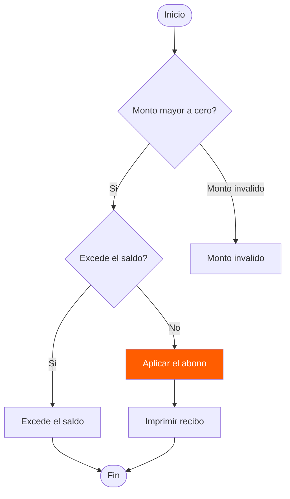
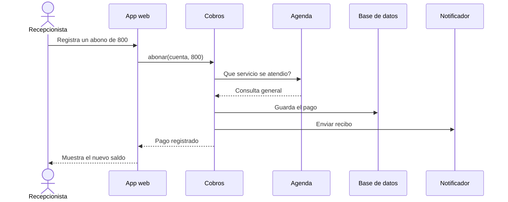
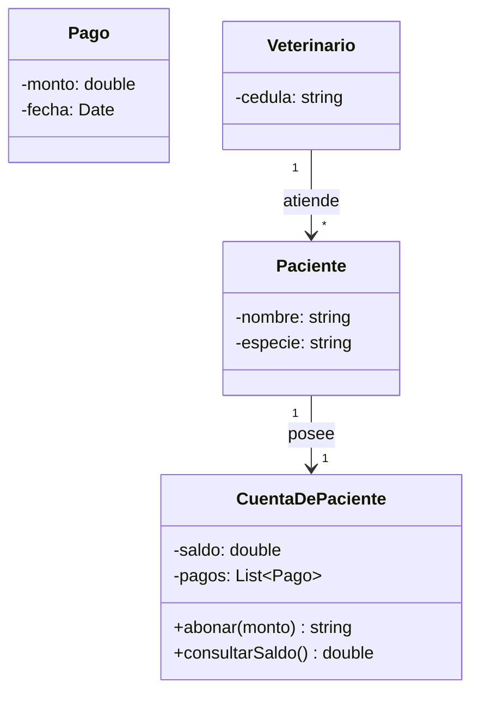
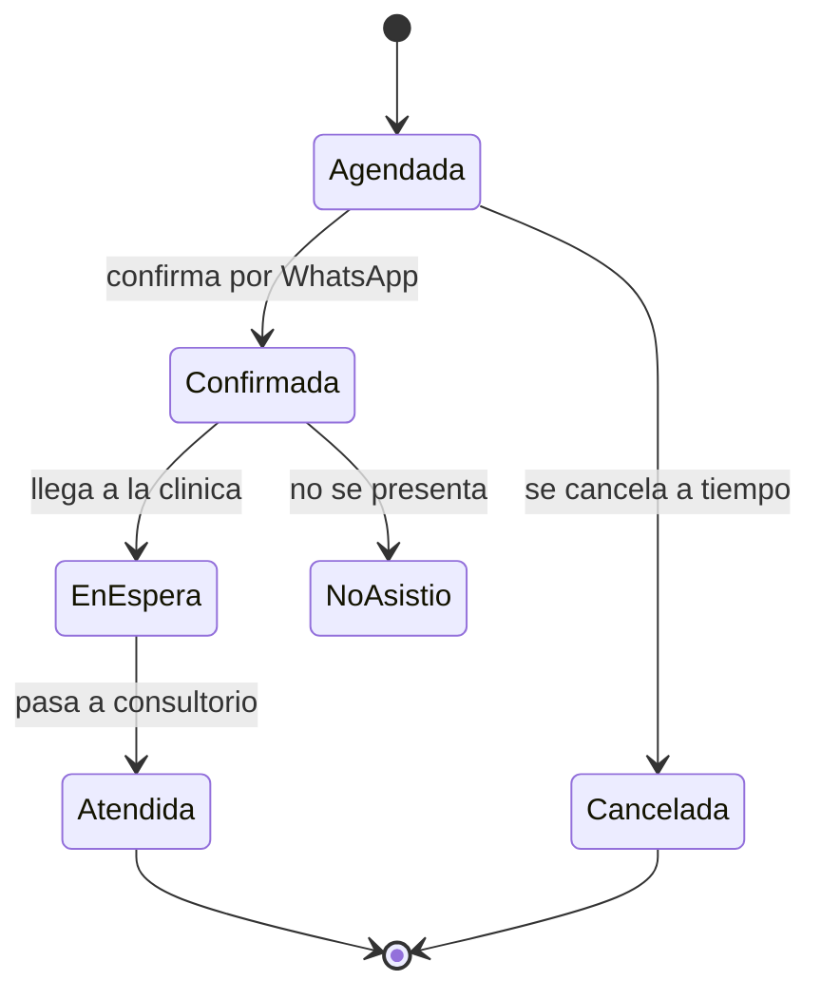
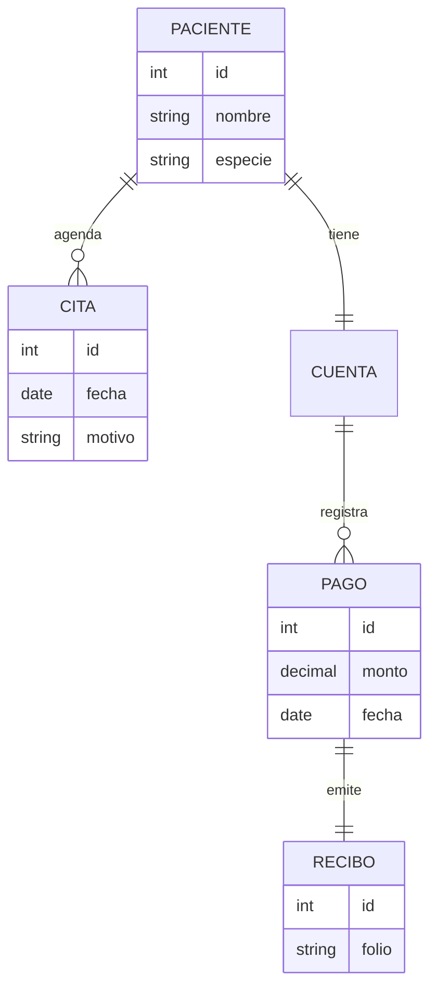
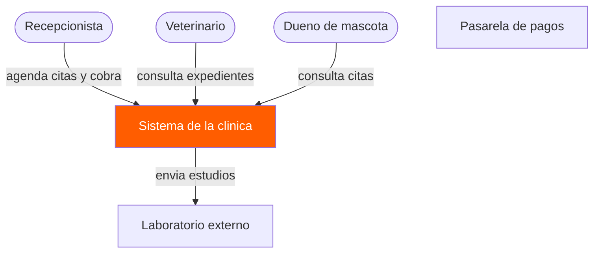
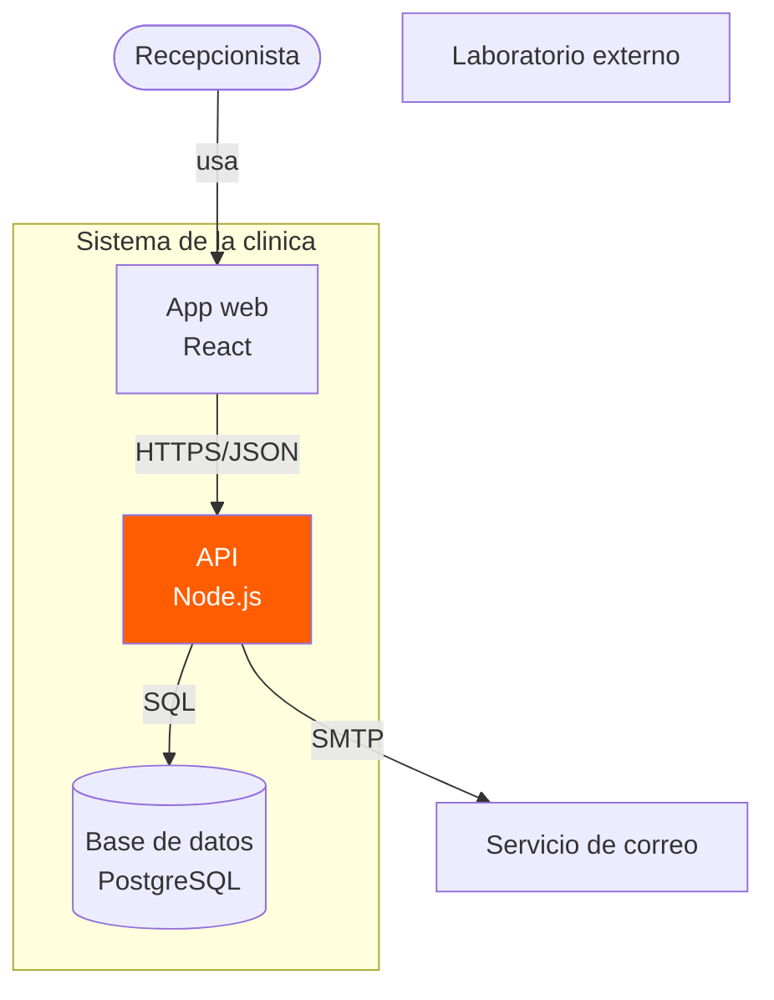
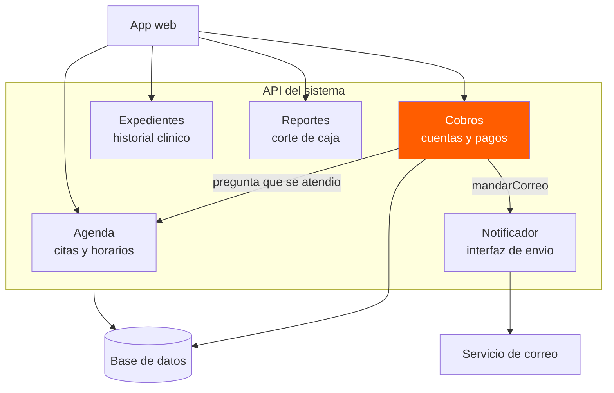

# Diagramas de ejemplo mermaid

## 1. Diagrama de flujo: registro de abono

## 2. Diagrama de secuencia: registro de un abono

## 3. Diagrama de clases

## 4. Diagrama de estados: ciclo de vida de una cita

## 5. Diagrama entidad-relación

## 6. Diagrama de contexto

## 7. Diagrama de contenedores

## 8. Diagrama de componentes

