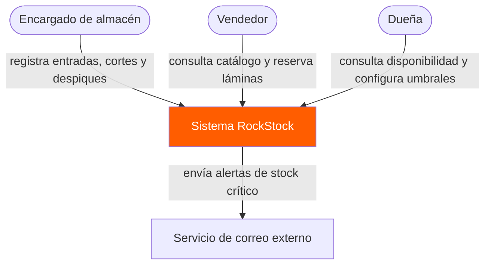
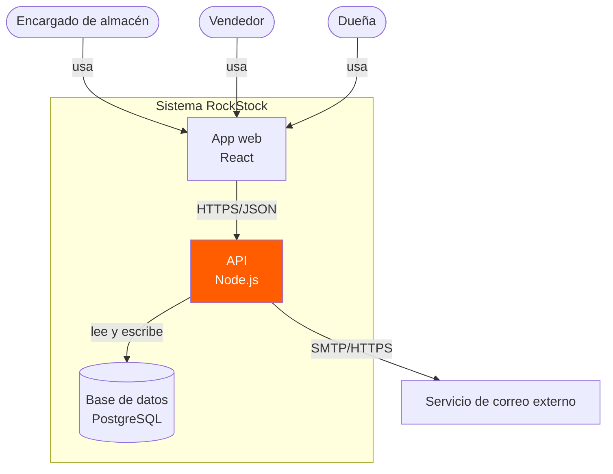
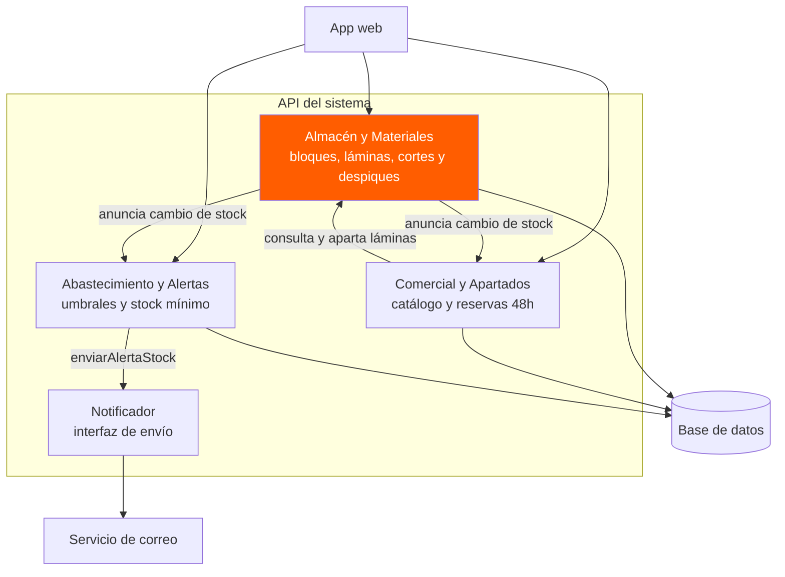
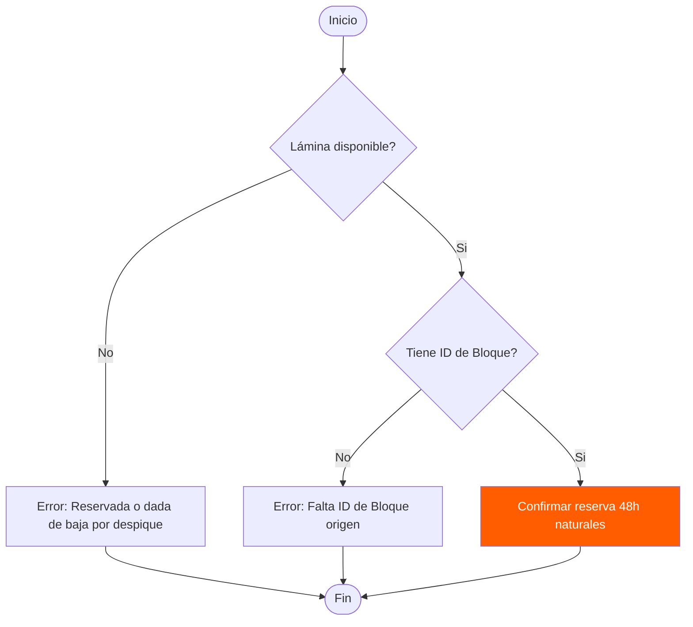
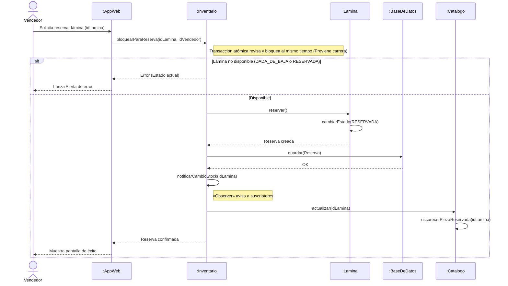
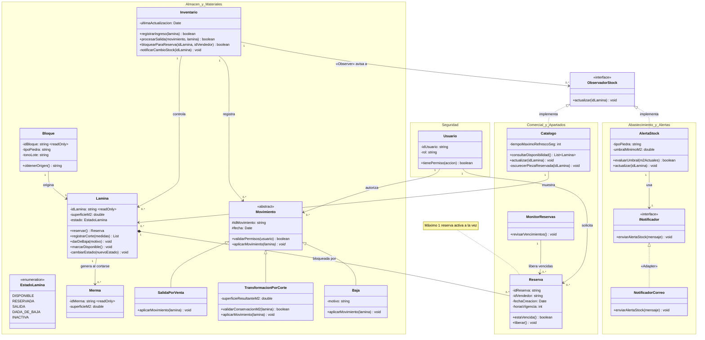
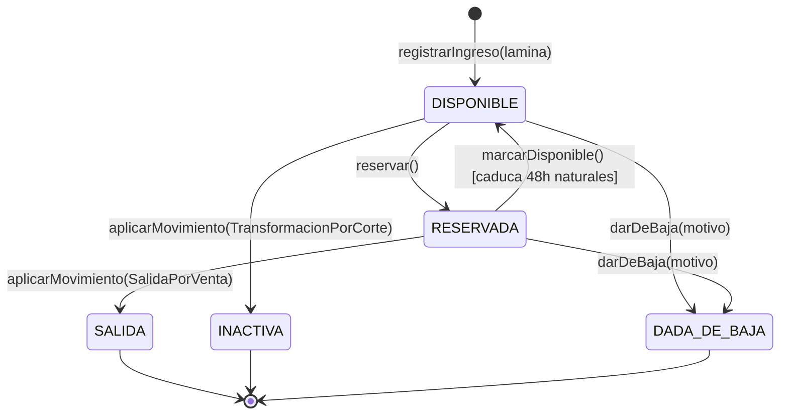
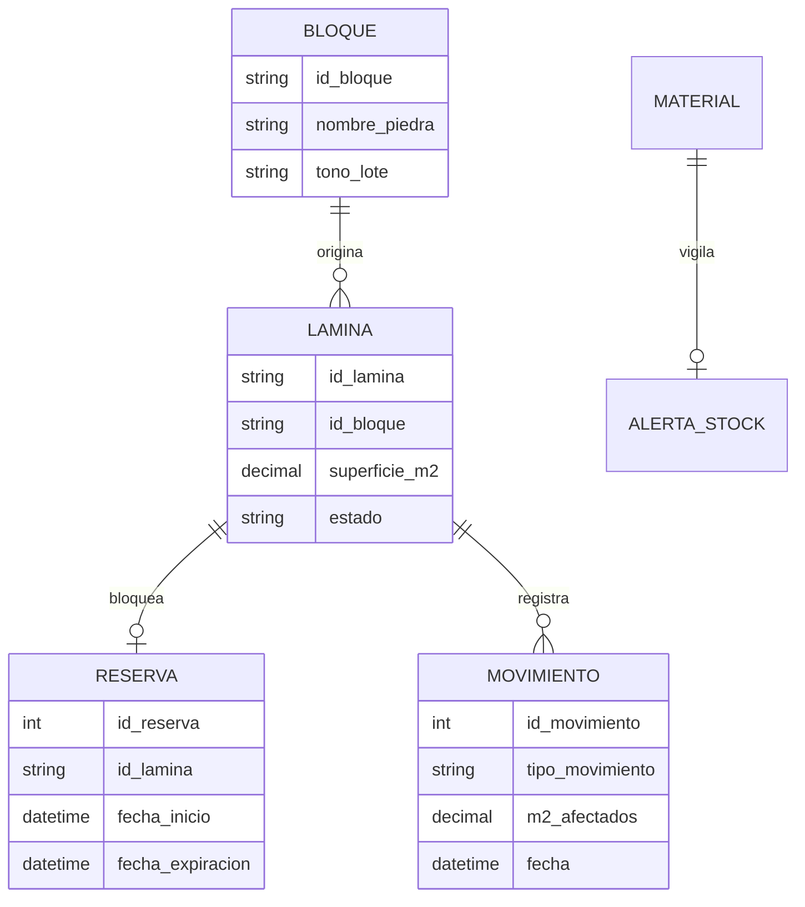

# Diagramas de Arquitectura (Modelo C4) · RockStock

**Sistema:** RockStock
**Autor:** César Méndez
**Curso:** Ingeniería de Software I · SIS3407

---

## 1. Nivel 1 · Diagrama de contexto
El sistema completo, quién lo usa y con quién habla (sin tecnología).

---

## 2. Nivel 2 · Diagrama de contenedores
Las piezas que se despliegan y se ejecutan por separado, usando `subgraph` para dibujar la frontera del sistema.

---

## 3. Nivel 3 · Diagrama de componentes
Lo que hay dentro del contenedor principal (`API del sistema`): los tres módulos de negocio y la interfaz `Notificador`.

---

## 4. Diagrama de flujo con decisiones
Validaciones del ejercicio de reserva y corte/conservación de superficie en RockStock.

---

## 5. Diagrama de secuencia
Cómo se pasan los mensajes entre objetos instanciados en orden y en el tiempo al reservar una lámina (CU-05), resolviendo la condición de carrera con una transacción atómica.

---

## 6. Diagrama de clases
Atributos, métodos, visibilidad y multiplicidad de las piezas principales de RockStock (aplicando Patrones GoF y Principios SOLID).

---

## 7. Diagrama de estados
Ciclo de vida de una Lámina en RockStock enlazado con las operaciones reales que disparan los cambios de estado.

---

## 8. Diagrama entidad-relación
Las tablas de la base de datos de RockStock y cómo se relacionan en su esquema físico.

