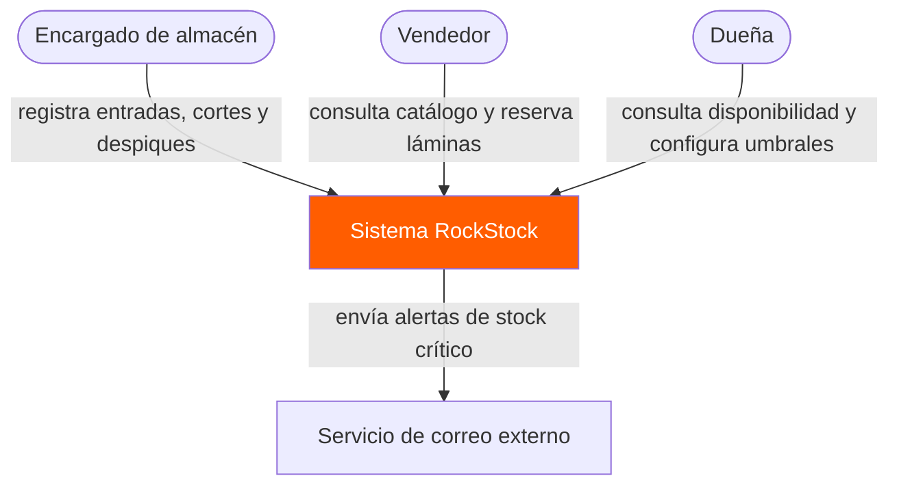
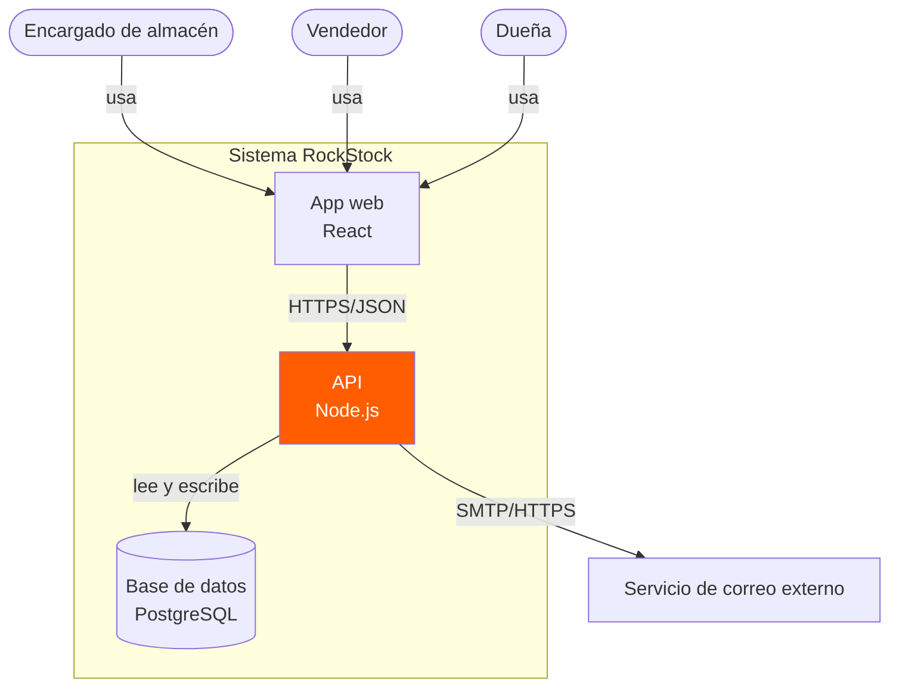
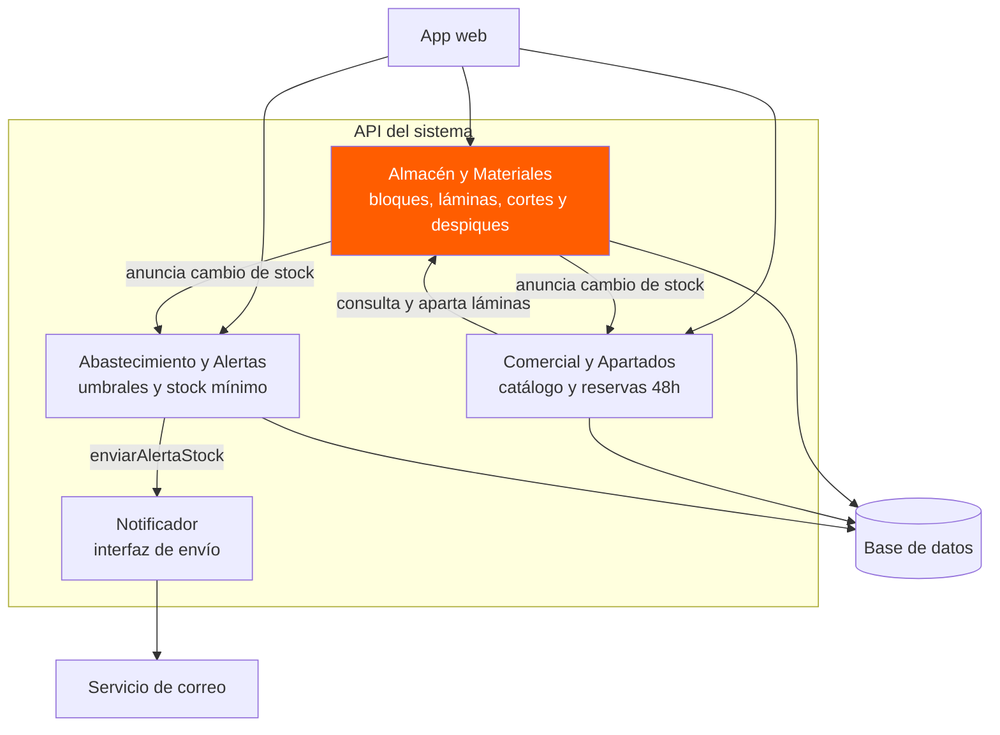

# Diagramas de Arquitectura (Modelo C4) · RockStock

**Sistema:** RockStock
**Autor:** César Méndez
**Curso:** Ingeniería de Software I · SIS3407

---

## 1. Nivel 1 · Diagrama de contexto
El sistema completo, quién lo usa y con quién habla (sin tecnología).

---

## 2. Nivel 2 · Diagrama de contenedores
Las piezas que se despliegan y se ejecutan por separado, usando `subgraph` para dibujar la frontera del sistema.

---

## 3. Nivel 3 · Diagrama de componentes
Lo que hay dentro del contenedor principal (`API del sistema`): los tres módulos de negocio y la interfaz `Notificador`.

